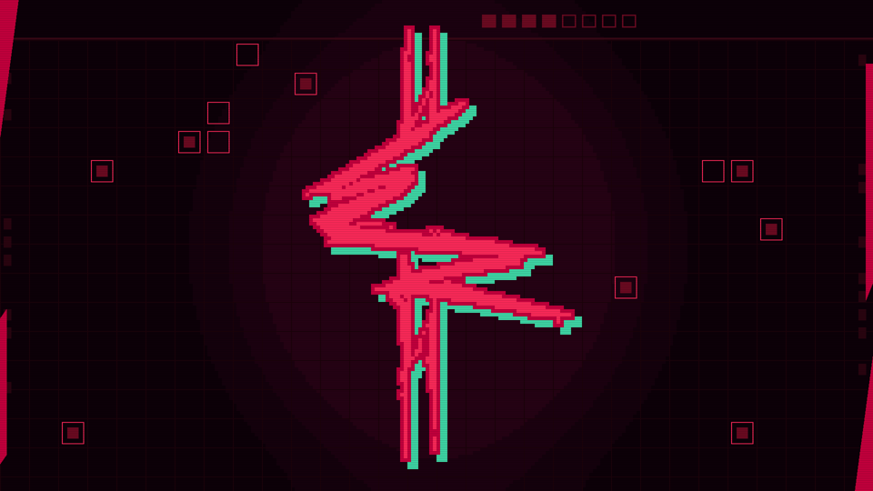

# Nasm_EdgeRunner_Render

A retro, glitching cyberpunk title screen written in pure x86-64 NASM assembly, rendered natively at 1920x1080 with SDL2.



## Features

- **Tile engine:** 80x45 grid of 24x24 tiles, 4bpp (16 colours), drawn 1:1 into a 1080p framebuffer
- **Glitch effects:** random bursts of band tearing, RGB channel splitting and tile corruption
- **Scanlines:** CRT-style darkening applied every frame
- **No C:** just NASM, SDL2 and a Linux syscall to exit

## Requirements

- Linux x86-64 (or WSL on Windows)
- `nasm`
- `libsdl2-dev`

```bash
sudo apt install nasm libsdl2-dev
```

## Build & Run

```bash
nasm -f elf64 edgerunners_1080p.asm -o edgerunners_1080p.o
ld edgerunners_1080p.o -o edgerunners_1080p -lSDL2 -dynamic-linker /lib64/ld-linux-x86-64.so.2
./edgerunners_1080p
```

## Controls

| Key | Action |
|---|---|
| `F11` | Toggle fullscreen |
| `ESC` | Quit |

## Files

| File | Purpose |
|---|---|
| `edgerunners_1080p.asm` | Program: rendering, glitch effects, SDL window and event loop |
| `tiles.asm` | Art: palette, tile data and tilemap |

## Tuning

Adjust the `%define`s at the top of `edgerunners_1080p.asm`:

| Define | Effect |
|---|---|
| `GLITCH_CHANCE` | Lower = more frequent glitch bursts |
| `BURST_MIN` / `BURST_RAND` | Burst length in frames |
| `BANDS_MAX` | Number of torn bands per glitch frame |
| `SHIFT_STEPS` | How far bands slide |
| `CORRUPT_MAX` | Random tiles drawn per glitch frame |
| `SCANLINE_STEP` | Darken every Nth row |

## Disclaimer

Fan project. Not affiliated with or endorsed by CD PROJEKT RED or Studio Trigger. *Cyberpunk: Edgerunners* and its logo are the property of their respective owners.
